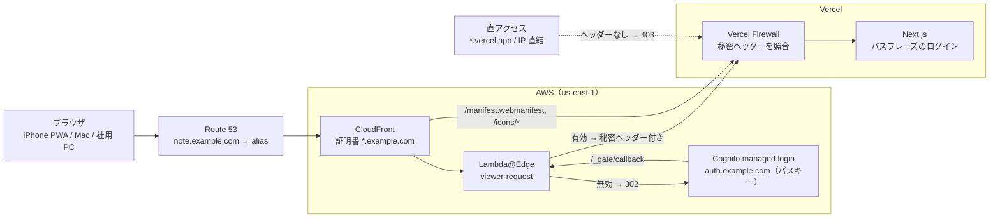
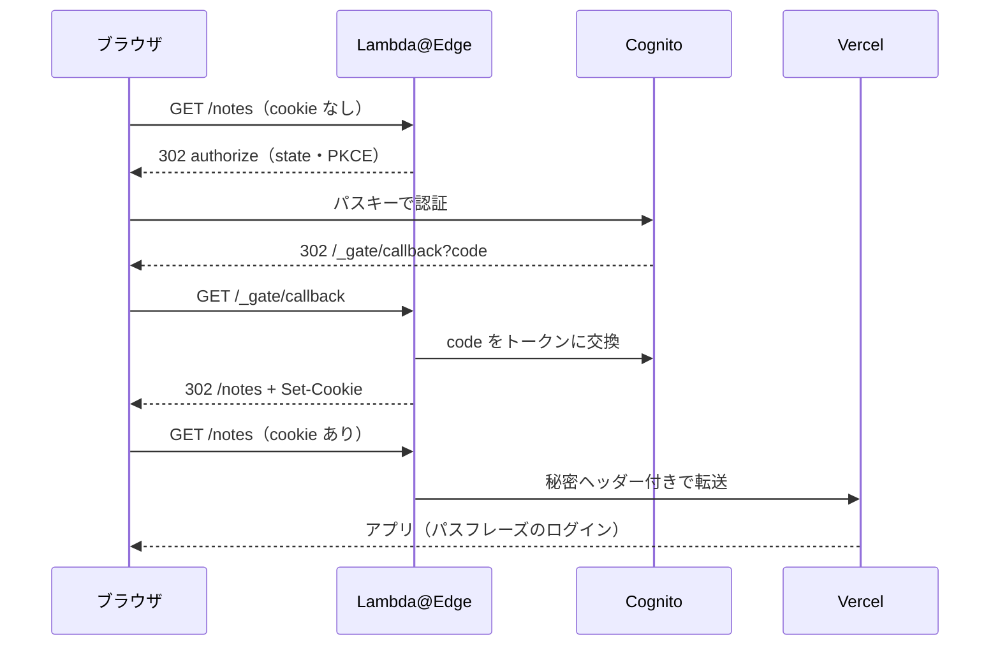

にっしー（@yukinissie）です。

自分専用のノートアプリを Vercel で動かしています。鍵はアプリのパスフレーズ 1 枚だけで、ログイン画面は世界中の誰でも開ける状態でした。さすがに心細いので、アプリの手前に「**パスキーで認証した人しか入口に立てない関門**」を置きました。

Cloudflare Access を使えば一発なのですが、DNS は Route 53 にあって動かしたくない。そこで AWS の部品だけで組みました。その構成と、途中でつまずいたところを書きます。

:::message
この記事のホスト名は仮のものです。アプリは `note.example.com`、ログイン画面は `auth.example.com`、Vercel 側のドメインは `xxxx.vercel.app` と書いています。
:::

# 何を作ったか

- 本番 `note.example.com` の前に CloudFront を立てる。Lambda@Edge が全リクエストで Cognito の ID トークンを確かめ、持っていなければパスキーのログイン画面へ送る
- パスキーは Cognito の managed login（`auth.example.com`）で、1Password に保存している。アプリのパスフレーズは内側の鍵としてそのまま残す（二重の鍵）
- Vercel への直接アクセスは、CloudFront だけが知る秘密のヘッダーと Vercel Firewall で塞ぐ
- 経路上の証明書は 3 枚とも自動更新。月額の費用はほぼゼロ

# なぜ Cloudflare Access ではないのか

この用途なら Cloudflare Access が定番です。ただ、Cloudflare Access をかけるには、ホスト名が Cloudflare を通っている（プロキシされている）必要があります。

Cloudflare の無料プランでは、ゾーン全体のネームサーバーを Cloudflare に移す（full setup）しかありません。サブドメインだけを Cloudflare に載せる partial setup は Business 以上、subdomain setup は Enterprise の機能です。同じドメインに他のサービスも載っているので、ネームサーバーは移したくありませんでした。

そこで、CloudFront を入口に、Lambda@Edge を検問に、Cognito をパスキーの認証に使って、同じものを組みました。

# 全体像



ポイントは 3 つです。

1. **DNS は Route 53 のまま。** 本番のレコードを、Vercel への CNAME から CloudFront への alias に替えただけです
2. **検問は CloudFront の入口でやる。** Lambda@Edge の viewer-request が全リクエストを見て、関門の cookie が有効なときだけ Vercel へ通します
3. **Vercel は CloudFront からしか受け付けない。** CloudFront が付ける秘密ヘッダーが無いリクエストは、Vercel Firewall が 403 で落とします

インフラは AWS CDK（TypeScript）で書いています。スタックは 2 つです。

| スタック | 中身 |
|---|---|
| Auth | Cognito のユーザープール、`auth.example.com`、ACM の証明書、SSM パラメータ |
| Edge | ACM の証明書、Lambda@Edge、CloudFront |

Lambda@Edge は環境変数を持てません。そのため、Edge スタックは Auth スタックが SSM に書いたユーザープール ID とクライアント ID を合成時に lookup し、esbuild の `define` でバンドルに焼き込みます。焼き込むのは公開情報だけです。

```ts:lib/edge-stack.ts
const gate = new NodejsFunction(this, "Gate", {
  entry: fileURLToPath(new URL("../edge/index.ts", import.meta.url)),
  runtime: Runtime.NODEJS_24_X,
  memorySize: 128,
  timeout: Duration.seconds(5),
  bundling: {
    minify: true,
    define: { __GATE_CONFIG__: JSON.stringify(gateConfigFor(userPoolId, clientId)) },
  },
});
```

# 関門（Lambda@Edge）の中身

関門のロジックは、`handleViewerRequest(req, deps)` という 1 つの関数にまとめました。fetch・トークン検証・乱数・時刻を外から渡すので、ユニットテストで全部の分岐を叩けます。バンドルは約 24KB（gzip で約 8KB）で、Lambda@Edge のサイズ上限には遠く及びません。

## 振り分けの規則

| リクエスト | 関門の判断 |
|---|---|
| 知らない Host（`dxxxx.cloudfront.net` など） | 403。登録していない callback URL でログインへ送らない |
| `/_gate/callback` | state を照合し、PKCE の verifier を添えて認可コードをトークンに交換（PKCE の照合は Cognito 側）。受け取った ID トークンを検証してから cookie に入れ、元のページへ |
| `/_gate/refresh` | リフレッシュトークンで ID トークンを入れ直して戻る。失敗したらパスキーへ |
| `/_gate/logout` | リフレッシュトークンを Cognito で失効させ、cookie を消して Cognito の logout へ |
| ID トークンが有効 | 関門の cookie を Cookie ヘッダーから外してから Vercel へ転送 |
| ID 切れ + リフレッシュあり、GET | `/_gate/refresh?return=…` へ 302 で 1 回往復 |
| ID 切れ + リフレッシュあり、POST | その場で更新して転送。302 にすると書きかけの本文が消える |
| トークンなし、GET | state と PKCE verifier を作って Cognito の authorize へ |
| トークンなし、POST | 401 |

ハンドラ全体は try/catch で包み、想定外の例外が起きても、GET ならログインへ、POST なら 401 に倒します。Lambda@Edge が例外を投げると、CloudFront は実行エラーとして 503 を返し、利用者にはエラーページが出るだけだからです。

```ts:edge/gate.ts
export async function handleViewerRequest(req: CloudFrontRequest, deps: GateDeps): Promise<Result> {
  const host = hostOf(req);
  // 登録していない Host(dxxxx.cloudfront.net 等)では、未登録の callback URL でログインへ送らない
  if (!deps.config.allowedHosts.includes(host)) return plain(403, "Forbidden");
  try {
    return await route(req, host, deps);
  } catch (e) {
    // 例外を CloudFront に返すと利用者には 503(実行エラー)が見える。やり直せる形に倒す
    logGate("gate_exception", { uri: req.uri, method: req.method, error: e instanceof Error ? e.name : "unknown" });
    return isSafeMethod(req.method) ? startLogin(host, returnPathOf(req.uri, req.querystring), deps) : plain(401, "Unauthorized");
  }
}
```

## cookie とトークンの寿命

| cookie | 中身 | Max-Age |
|---|---|---|
| `__Host-yg-id` | Cognito の ID トークン（有効 60 分） | 30 日 |
| `__Host-yg-refresh` | リフレッシュトークン（有効 30 日、ローテーションなし） | 30 日 |
| `__Host-yg-login` | ログイン中だけの state・verifier・戻り先 | 10 分 |

属性はすべて `Secure; HttpOnly; SameSite=Lax; Path=/` で、`__Host-` 接頭辞を付けています。

自前の署名鍵は持ちません。Lambda@Edge は環境変数を持てないので、秘密を焼き込まずに済む方式を選びました。ID トークンは Cognito の JWKS で検証します（`aws-jwt-verify`）。

Cognito のリフレッシュトークンは最初のサインインから 30 日で切れ、使っても延びません（ローテーションを有効にしても、期限の窓は延びない仕様です）。そのため「パスキーで認証してから 30 日」が絶対期限になります。

## 30 日の境目で本文を失わないために

編集画面を開いたまま 30 日の期限をまたいで保存を押すと、POST は 401 になります。アプリは「通信かサーバーの様子を見て」と案内するだけで、原因が関門の期限切れだとは分かりません。直そうとして開き直すと、編集画面には下書きの退避が無いので、書いた本文が消えてしまいます。

そこで、29 日を過ぎたら**ページを開いた時点で**先にパスキーを求めるようにしました。

- **判定に使う値:** ID トークンの `auth_time`（ユーザーが認証した時刻）です。リフレッシュで入れ直したトークンでも元の時刻のまま、という前提で使っています。Cognito の公式ドキュメントには明記がなく、利用者の報告があるだけです。もし更新されてしまう場合でも、先回りが効かず、30 日の期限で止まるだけです
- **ページ移動の見分け方:** `Sec-Fetch-Mode: navigate` で見分けます
- **対象のメソッド:** GET と HEAD だけです

```ts:edge/gate.ts
if (verified?.ok) {
  // GET・HEAD のページ遷移だけ。ページ遷移の POST(ログアウトのフォーム送信)を回すと、
  // パスキーの後に GET で戻ってしまい、ログアウトが成立しない
  if (isSafeMethod(req.method) && isNavigation(req) && nearExpiry(deps, verified.authTime)) {
    return startLogin(host, returnTo, deps);
  }
  return forward(req);
}
```

:::message
最初はメソッドを見ていませんでした。後でログアウトをふつうのフォーム送信（ページ移動の POST）にしたところ、29 日目のログアウトが再認証に回されました。パスキーの後に `GET /logout` へ戻って 405 になり、ログアウトできないまま関門の期限だけが延びる、というバグです。レビューで見つかりました。
:::

# パスキー（Cognito）

Cognito のユーザープールは Essentials プランにしました（月 10,000 MAU まで無料）。managed login でパスキー（WebAuthn）を first factor として有効にし、user verification は必須にしています。ユーザーは自分 1 人で、管理者だけが作れます。

```ts:lib/auth-stack.ts
this.userPool = new UserPool(this, "UserPool", {
  featurePlan: FeaturePlan.ESSENTIALS,
  selfSignUpEnabled: false,
  signInAliases: { email: true },
  signInPolicy: { allowedFirstAuthFactors: { password: true, passkey: true } },
  passkeyRelyingPartyId: "auth.example.com",
  passkeyUserVerification: PasskeyUserVerification.REQUIRED,
  mfa: Mfa.OFF,
  // メールでのパスワード再設定を開けると、受信箱がパスキーを迂回する第二の鍵になる
  accountRecovery: AccountRecovery.NONE,
  passwordPolicy: { minLength: 64 /* 文字種の要求は外す */ },
  deletionProtection: true,
});
```

## PASSWORD は外せない

一番の落とし穴でした。Cognito の choice-based sign-in では、サインイン手段から `PASSWORD` を外せません（上の `password: true`）。そのままだと、パスキーとパスワードの弱いほうが関門の強さになってしまいます。

対策は次の 3 つです。

- パスワードは、最初のパスキー登録にだけ使う
- 登録が済んだら、誰も保存しない 64 文字のランダム値に差し替えて捨てる（`admin-set-user-password --permanent`）。経路は理論上残りますが、知っている人がいません
- メールでのパスワード再設定も閉じる（`AccountRecovery.NONE`、CloudFormation では `admin_only`）

復旧は AWS の管理者権限で行います。CDK のテストでは、`admin_only` であることと、SDK 向けの認証フローが `ALLOW_USER_AUTH` と `ALLOW_REFRESH_TOKEN_AUTH` だけであることを固定しています。

## ログイン画面は自分のドメインに

managed login をカスタムドメインで使うと、パスキーの RP ID はそのドメインの FQDN に縛られます。後でドメインを変えると、1Password のパスキーも物理キーも全部登録し直しです。だから最初から `auth.example.com` にしました。

:::message
管理者が作ったユーザーには、managed login はパスキーの登録を勧めません（Cognito のドキュメントに明記されています）。登録は `https://auth.example.com/passkeys/add?client_id=…&redirect_uri=…` を直接開いて行います。
:::

## 初回ログインの流れ



iPhone のホーム画面 PWA でも、この流れで問題なく動きました。PWA から見ると `auth.example.com` は自分のスコープの外ですが、1Password のパスキーで通ったあと、PWA 本体に戻ってこられます。

# Vercel を「CloudFront からだけ」にする

関門を置いても、Vercel 側の URL を直接開かれたら意味がありません。Vercel は本番のデプロイに `xxxx.vercel.app` のようなドメインを自動で割り当てます。調べると、これは Vercel のログイン（Deployment Protection）なしで誰でも開ける状態でした。

そこで、CloudFront は origin に送るすべてのリクエストに秘密のヘッダーを付けます。値は 1Password で作った 48 文字のランダムな英数字です。

```ts:lib/edge-stack.ts
const origin = new HttpOrigin("xxxx.vercel.app", {
  protocolPolicy: OriginProtocolPolicy.HTTPS_ONLY,
  customHeaders: { "x-origin-verify": props.originVerifySecret },
});
```

Vercel Firewall には、次のルールを 1 本置きました。

```text
If   Request Header  x-origin-verify  does not equal  ••••••••
Then Deny
```

値は手元では 1Password にだけ保管し、デプロイのときに環境変数で CDK に渡します。リポジトリには書きません（もちろん、CloudFront と Vercel Firewall の設定の中には入っています）。

## Host を転送しない理由

CloudFront から Vercel へは、viewer の Host（`note.example.com`）を渡さず、`xxxx.vercel.app` のままつないでいます。CloudFront の origin request policy は `AllViewerExceptHostHeader` です。

Host を渡すと、CloudFront は Vercel の証明書をその名前で検証します。ところが、DNS が CloudFront を向いた後は、Vercel の Let's Encrypt 証明書は ACME の確認通信が CloudFront を素通りできたときしか更新されません。更新に失敗して証明書が切れると、ブラウザ側の鍵マークは正常なまま、全ページが 502 になります。`*.vercel.app` につなげば、証明書は Vercel 全体のもので、こちらが心配する必要はありません。

代わりに、Next.js の Server Actions が CSRF 対策で比べる「Origin のホスト」と「Host」が食い違ってしまいます。ブラウザから見た Origin は `note.example.com`、Next.js から見た Host は `xxxx.vercel.app` だからです。このままだとログインを含む全フォームが拒否されるので、公開ホスト名を許可リストに足しました。

```ts:next.config.ts
const nextConfig: NextConfig = {
  experimental: {
    serverActions: {
      allowedOrigins: ["note.example.com"],
    },
  },
};
```

この設定は、DNS がまだ Vercel を直接向いているうちに先に出しました。その間は同一オリジンなので、出しても挙動は変わりません。

:::message
関門を通さない behavior（manifest とアイコン）には、origin request policy を付けていません。付けると、Lambda@Edge を通らない経路なので関門の cookie を外す人がおらず、リフレッシュトークン入りの cookie が Vercel に渡ってしまいます。これもレビューで見つかりました。
:::

## 秘密ヘッダーは盗まれないのか

この構成の守りは「秘密ヘッダーの値を知っているのは CloudFront だけ」という前提に乗っています。では、CloudFront から Vercel までの間で盗まれることはないのでしょうか。

結論から言うと、**通信路の途中で盗まれることは、まずありません。** 現実的なのは、通信の両端と、設定を読める場所から漏れるほうです。

### 通信路の上

- CloudFront → Vercel は HTTPS だけで送ります（origin protocol policy は `https-only`）
- CloudFront は origin の証明書を検証します。正規の認証局が発行し、期限内で、名前が接続先（`xxxx.vercel.app`）に一致する証明書でなければ接続しません。間に割り込むには `*.vercel.app` の正規の証明書が要るので、現実的ではありません
- ヘッダーは CloudFront が origin へ送る瞬間に付けます。ブラウザとの間のリクエストにもレスポンスにも出てこず、viewer-request の Lambda@Edge にも渡りません

### 値が置かれている場所

| 場所 | 読める人 |
|---|---|
| CloudFront のディストリビューションの設定 | AWS アカウントで設定を読める人（`cloudfront:GetDistributionConfig`） |
| CloudFormation のテンプレート | AWS アカウントでテンプレートを読める人（`cloudformation:GetTemplate`） |
| デプロイした手元の `cdk.out/` | 手元のマシンを触れる人（gitignore していても、合成したテンプレートに平文で残る） |
| Vercel Firewall のルール | Vercel のプロジェクトの設定を見られる人 |
| Next.js アプリが受け取るリクエストヘッダー | アプリのコード |

筆者の環境で、値そのものは表示せずに照合して確かめました。CloudFront の設定・CloudFormation のテンプレート・手元の `cdk.out/` には入っていました。CloudTrail の作成・更新イベントとシェルの履歴には見つかりませんでした。`cdk.out/` はデプロイが終わったら消しています。

見落としやすいのは最後の行です。CloudFront が付けたヘッダーは Vercel を素通りして、アプリまで届きます。今のアプリはヘッダーをログに出しておらず、画面にも返していません。ただし将来エラー監視サービスを入れて、リクエストのヘッダーを丸ごと送る設定にすると、値がそのサービスに渡ってしまいます。

### 盗まれたら何が起きるか

攻撃者は `xxxx.vercel.app` に直接、ヘッダー付きでつなげるようになり、パスキーの関門を迂回できます。

それでも、その先にはアプリのパスフレーズ（内側の鍵）と、`/login` のレート制限が残っています。直接つなぐ経路では、レート制限は攻撃者自身の IP ごとにかかります。二重の鍵にしてあるのは、こういうときのためです。

値の入れ替えは、本人が締め出されない順序で行います。

1. Vercel Firewall のルールを「旧値・新値のどちらとも一致しなければ Deny」に変える
2. 新しい値で CloudFront をデプロイする
3. CloudFront に反映されたら、Firewall から旧値を外す

### さらに固めるなら

いまはやっていませんが、次のような手があります。

- 値を定期的に入れ替える
- 「リクエストのヘッダーをログや外部サービスに出さない」をプロジェクトの規約にしておく
- 時刻入りの署名付きヘッダー（Lambda@Edge の origin-request で HMAC を付け、アプリ側で検証）にして、盗まれても使える時間を短くする。ただし、アプリが関門のことを知る範囲が広がる
- Vercel の Trusted IPs で、CloudFront の IP 帯からの接続だけに絞る（Enterprise プランの機能）

# 証明書：3 枚とも自動更新。ただし CAA に一度つまずいた

| 区間 | 証明書 | 更新 |
|---|---|---|
| ブラウザ → CloudFront | ACM `*.example.com` | ACM が自動（DNS 検証） |
| ブラウザ → Cognito | ACM `auth.example.com` | ACM が自動（DNS 検証） |
| CloudFront → Vercel | Vercel の `*.vercel.app` | Vercel が管理 |

初回のデプロイでは、CloudFront 用の証明書を本番名で取ろうとして、ACM の検証が `FAILED` になりました。検証用の CNAME は CDK が Route 53 にちゃんと置いていました。

原因は CAA です。本番名はまだ Vercel への CNAME で、CA は CAA を CNAME の先まで辿って調べます。Vercel 側の CAA は Let's Encrypt・Google・Sectigo・GlobalSign しか許していないので、Amazon は発行できません。

```shell
$ dig +short CAA note.example.com
xxxx.vercel-dns-016.com.
0 issue "pki.goog"
0 issue "sectigo.com"
0 issue "globalsign.com"
0 issue "letsencrypt.org"
```

ワイルドカード `*.example.com` の CAA は、親の `example.com` で検査されます。親には CAA が無いので発行できました。鍵は ACM の中にあり CloudFront でしか使えないので、対象が広いことの実害は小さいと判断しました。

:::message alert
他社の CDN やホスティングへ CNAME している名前を、CloudFront に付け替える移行では要注意です。切り替え前に用意したい証明書が、まだ旧サービスを向いている CNAME の CAA に縛られます。
:::

# ログアウト：アプリから出たら、Cognito からも出る

最初はアプリと関門を完全に切り離していました。しかしこれだと、アプリでログアウトしても関門と Cognito のログイン状態は残ります。次に開くと、パスキーなしでアプリのログイン画面まで入れてしまいます。そこで、アプリが関門について知るのを `/_gate/logout` というパス 1 つだけに限って、つなぎました。

```ts:app/logout/route.ts
export async function POST(): Promise<NextResponse> {
  // Location は必ず相対パス。Host が xxxx.vercel.app なので、絶対 URL だと vercel.app へ飛んで 403 になる
  const res = new NextResponse(null, { status: 303, headers: { Location: "/_gate/logout" } });
  res.cookies.set(SESSION_COOKIE, "", { ...sessionCookieOptions(), maxAge: 0 });
  return res;
}
```

ログアウトボタンは Server Action をやめ、`<form action="/logout" method="post">` のふつうのフォーム送信にしました。Server Action の中で `redirect("/_gate/logout")` すると、Next.js がアプリ内の遷移として RSC を取りに行こうとするためです。ふつうのフォーム送信と 303 なら、ブラウザがページごと移動します。

関門はリフレッシュトークンを Cognito の `/oauth2/revoke` で失効させてから cookie を消し、Cognito の logout を経てトップへ戻します。

関門の無い開発環境では、`/_gate/logout` はアプリの middleware（Next.js 16 では `proxy.ts`）が `/login` へ回すので、今までどおりに動きます。

ID トークンは JWT を手元で検証しているので、途中で無効にできません。cookie から抜き取られていた場合は、ログアウト後も最長 60 分は関門を通れます。ここは割り切りました。

# 運用

## ログ

関門は失敗をすべて「やり直せる応答」に倒しています。そのぶん、何が起きたかは CloudWatch Logs に JSON 1 行で残します。出すのは事象の名前と、HTTP ステータス・エラーの種類・パスといった付帯情報だけで、トークン・cookie・認可コードの値は出しません。

| 事象 | 意味 |
|---|---|
| `token_endpoint_error` / `_unreachable` | トークン交換・更新が拒否された / 届かなかった |
| `id_token_invalid` | 署名や発行元が合わない（期限切れは平常なので出さない） |
| `callback_rejected` | state の不一致、login cookie が無い |
| `refresh_token_revoked` | ログアウトで失効できた |
| `token_revoke_error` / `_unreachable` | 失効が拒否された / 届かなかった（ログアウトは止めない） |
| `gate_exception` | 想定外の例外 |

Lambda@Edge のログは、実行されたエッジに近いリージョンの `/aws/lambda/us-east-1.<関数名>` に出ます。筆者の環境（日本から）では東京リージョンに出ていました。

このログは検証にも使えました。Cognito で `admin-user-global-sign-out` してから 60 分後（ID トークンの寿命）に iPhone の PWA を開くと、`{"gate":"token_endpoint_error","grant":"refresh_token","status":400,"error":"invalid_grant"}` が出て、パスキーの画面に戻りました。期限切れからの再ログインが本当に動くことを、ログで確かめられます。

## 切り替えと戻し方

本番の切り替えは、Route 53 の change batch 1 回で行いました。CNAME の削除と、A・AAAA の alias の作成をアトミックに当てるので、名前が引けない時間はありません。切り替え用と戻し用の JSON は、小さなスクリプトで作っています。

```json
{
  "Changes": [
    { "Action": "DELETE", "ResourceRecordSet": { "Name": "note.example.com.", "Type": "CNAME", "TTL": 60, "ResourceRecords": [{ "Value": "xxxx.vercel-dns-016.com." }] } },
    { "Action": "CREATE", "ResourceRecordSet": { "Name": "note.example.com.", "Type": "A", "AliasTarget": { "HostedZoneId": "Z2FDTNDATAQYW2", "DNSName": "dxxxx.cloudfront.net.", "EvaluateTargetHealth": false } } },
    { "Action": "CREATE", "ResourceRecordSet": { "Name": "note.example.com.", "Type": "AAAA", "AliasTarget": { "HostedZoneId": "Z2FDTNDATAQYW2", "DNSName": "dxxxx.cloudfront.net.", "EvaluateTargetHealth": false } } }
  ]
}
```

DELETE は、既存レコードと TTL・値が完全に一致しないと失敗します。そのため、「現状を確かめてから切り替える」安全装置にもなっています。

もう 1 つ、本番名も最初から CloudFront の代替ドメインに入れておきました。Host を転送しない構成なので、DNS が Vercel を向いているうちは何も起きません。おかげで、切り替えは DNS の変更 1 回で済みました。

戻すときは順番が大事です。先に Firewall の Deny を無効にしてから、DNS を Vercel に戻します。逆にすると、自分が締め出されます。

## 費用

| 項目 | 費用 |
|---|---|
| Cognito | Essentials の無料枠（10,000 MAU）に収まる |
| CloudFront | 常時無料枠（1TB・1,000 万リクエスト）に収まる |
| Lambda@Edge | 月に数円〜数十円 |
| ACM・Route 53 のレコード追加 | 無料 |

# まとめ：つまずいたところ

- **CAA は CNAME の先まで辿られる。** 切り替え前に要る証明書は、親で検査されるワイルドカードで取る
- **Cognito の PASSWORD は外せない。** パスワードを誰も知らない値にし、メールでの再設定も閉じる
- **関門を通らない経路では、cookie を外す人がいない。** バイパスの behavior には origin request policy を付けない
- **CDK のテストで esbuild を止めていると、実際のバンドルを誰も組み立てていない。** `define` で設定を焼き込んだバンドルを作って実行するテストを、別に置いた
- **ページ移動の POST は、まれだが存在する。** 「navigate なら再認証」のような規則は、GET・HEAD に限る
- **手元で検証する ID トークンは止められない。** Cognito で失効させても、署名と期限だけを見る検証は期限まで通る。止めたいなら寿命を短くして、リフレッシュトークンを失効させる

DNS を動かせない事情があっても、AWS の部品だけでパスキーの関門は作れました。AWS 側の部品は CDK でコードになっています。手作業の部分（本番レコードの切り替え・Cognito のユーザー・Vercel Firewall）も手順を残してあるので、壊しても作り直せます。
